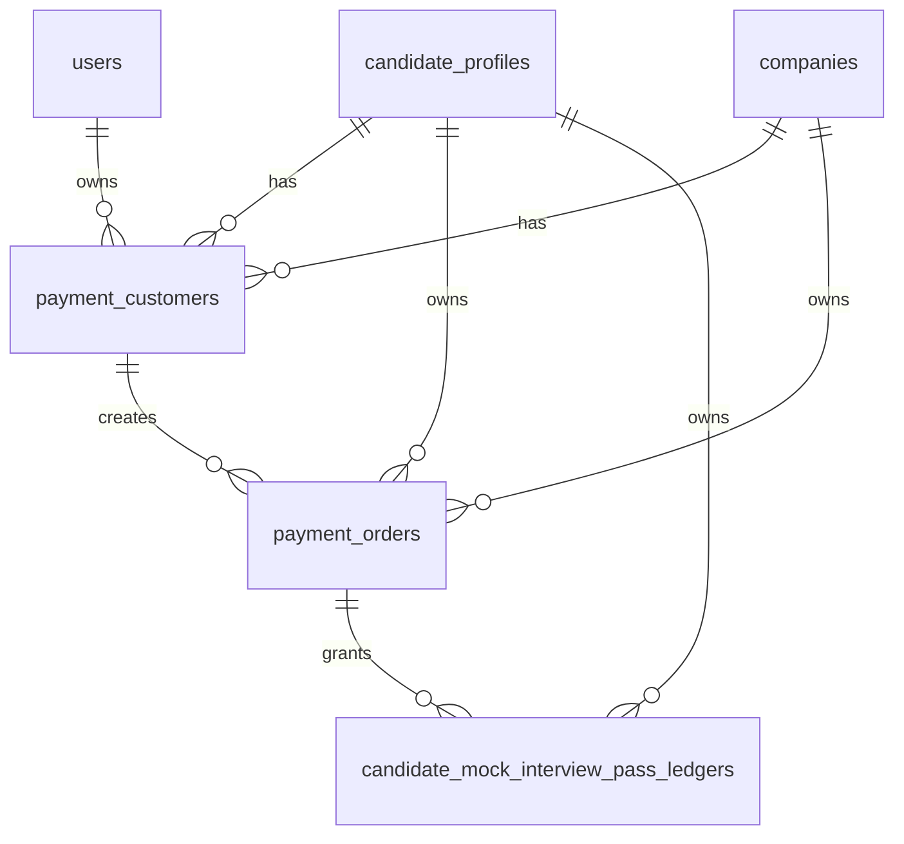

# ERD

## Payment Addendum

상세 PM ERD 문서: `.PM/payments/결제-erd.md`

새 결제 관계 요약:

> Source: `init/docs/00_source` 기준. Generated at 2026-06-27.

ERDCloud SQL을 사람이 읽는 테이블/관계 문서로 변환한다.

## Source Files

- ERDCloud import SQL: `docs/02_architecture/erdcloud/init_erd_v0.5_refined_erdcloud.sql`
- Human-readable model: `docs/02_architecture/data-model.md`
- Human-readable relationships: `docs/02_architecture/erd.md`
- Runtime migrations: `infra/db/migrations`

`erdcloud/*.sql`은 설계/ERDCloud import용 기준 DDL이다. 실제 애플리케이션에서 실행할 PostgreSQL migration은 `infra/db/migrations`에 별도로 작성한다.

## Design Notes

- `email_verifications` 테이블은 제거되었고 인증 코드는 Redis/TTL 캐시에서 관리한다.
- 평가 기준은 자유 서술이 아니라 `criterion_tags`를 선택해 `evaluation_criteria`로 연결한다.
- `embeddings`는 JD, 질문, 서류, 답변, 리포트 검색/추천/근거 조회를 위한 공통 저장소다.
- 파일 원본은 Object Storage에 두고 `file_assets.storage_key`로 참조한다.
- ERDCloud SQL은 sequence/identity, runtime index, check constraint, migration rollback 정책을 확정하는 파일이 아니다.
- 구현에서는 ERD table 이름을 그대로 유지하고 Prisma model은 `docs/02_architecture/data-model.md`의 `Implementation Naming Baseline`을 따른다.
- `question_bank`는 Prisma model `Question`, `evaluation_criteria`는 `EvaluationCriterion`, `ai_process_logs`는 `AiProcessLog`로 구현한다.
- `NCS_ACTIVE_PROFILE_V2`는 `evaluation_criteria.weight > 0`을 활성 기준으로 사용하고 별도 active column을 만들지 않는다.
- 기존 row는 `interview_sessions.session_mode=STANDARD`와 질문/batch의 `usage_scope=STANDARD`로 해석한다. DEMO_PRESET 개인화 batch는 usage scope가 포함된 business key로 STANDARD와 격리한다.

## Table Summary

| Table | PK | Columns | Purpose | Outgoing FK |
| --- |--- |--- |--- |--- |
| users | user_id | 11 | 서비스 계정과 인증 방식 |  |
| companies | company_id | 12 | 기업 프로필과 평가 정책 | logo_file_id -> file_assets.file_id |
| file_assets | file_id | 9 | 사용자별 업로드 멱등 키를 포함한 파일 메타데이터 | owner_user_id -> users.user_id |
| candidate_profiles | candidate_id | 9 | 지원자 프로필, 자기소개서와 기본 이력서 | user_id -> users.user_id / default_resume_file_id -> file_assets.file_id |
| candidate_educations | education_id | 11 | 지원자 학력 | candidate_id -> candidate_profiles.candidate_id |
| candidate_careers | career_id | 13 | 지원자 경력 | candidate_id -> candidate_profiles.candidate_id |
| candidate_activities | activity_id | 11 | 지원자 프로젝트·경험·활동·교육 | candidate_id -> candidate_profiles.candidate_id |
| candidate_credentials | credential_id | 10 | 지원자 자격·어학·수상 | candidate_id -> candidate_profiles.candidate_id |
| postings | posting_id | 10 | 채용 공고/JD | company_id -> companies.company_id |
| criterion_tags | tag_id | 7 | 평가 태그 후보 |  |
| evaluation_criteria | criterion_id | 7 | 공고별 평가 기준, 상세 설명 스냅샷과 가중치 | posting_id -> postings.posting_id / tag_id -> criterion_tags.tag_id |
| question_bank | question_id | 19 | usage scope와 NCS snapshot을 포함한 면접 질문 뱅크 | company_id -> companies.company_id / posting_id -> postings.posting_id / criterion_id -> evaluation_criteria.criterion_id |
| interview_question_sets | question_set_id | 7 | 공고별 면접 질문 세트 | posting_id -> postings.posting_id / created_by_process_log_id -> ai_process_logs.process_log_id |
| interview_question_set_items | question_set_item_id | 5 | 면접 질문 세트 항목 | question_set_id -> interview_question_sets.question_set_id / question_id -> question_bank.question_id / criterion_id -> evaluation_criteria.criterion_id |
| interview_time_policies | posting_id | 6 | 공고별 면접 시간 정책 | posting_id -> postings.posting_id |
| applications | application_id | 12 | 제출 프로필 스냅샷을 포함한 지원서와 전형 상태 | posting_id -> postings.posting_id / candidate_id -> candidate_profiles.candidate_id |
| application_documents | document_id | 7 | 지원서 첨부 서류와 파싱 결과 | application_id -> applications.application_id / file_id -> file_assets.file_id |
| consent_records | consent_id | 5 | 지원/면접 동의 이력 | application_id -> applications.application_id |
| application_interview_question_batches | batch_id | 16 | usage-scoped 개인화 질문 생성 batch와 멱등 snapshot | application_id -> applications.application_id / latest_process_log_id -> ai_process_logs.process_log_id |
| application_interview_questions | personalized_question_id | 19 | STANDARD/DEMO_PRESET 지원자별 질문 | batch_id -> application_interview_question_batches.batch_id / criterion_id -> evaluation_criteria.criterion_id / source_process_log_id -> ai_process_logs.process_log_id |
| interview_sessions | session_id | 14 | STANDARD/DEMO_PRESET mode snapshot을 포함한 모의/채용 면접 세션 | application_id -> applications.application_id / candidate_id -> candidate_profiles.candidate_id |
| interview_session_questions | session_question_id | 24 | usage scope를 포함한 불변 런타임 질문 snapshot | session_id -> interview_sessions.session_id / question_id -> question_bank.question_id / personalized_question_id -> application_interview_questions.personalized_question_id |
| interview_answers | answer_id | 8 | 질문별 영상/음성/STT 답변 | session_id -> interview_sessions.session_id / question_id -> question_bank.question_id / video_file_id -> file_assets.file_id / audio_file_id -> file_assets.file_id |
| follow_up_questions | follow_up_id | 13 | 답변 기반 꼬리질문 결정과 private session question 승격 상태 | answer_id -> interview_answers.answer_id, source_session_question_id/inserted_session_question_id -> interview_session_questions.session_question_id |
| evaluation_reports | report_id | 8 | 평가 리포트 헤더 | application_id -> applications.application_id / session_id -> interview_sessions.session_id |
| report_scores | score_id | 5 | 평가 항목별 점수 | report_id -> evaluation_reports.report_id / criterion_id -> evaluation_criteria.criterion_id |
| ncs_answer_evaluations | ncs_evaluation_id | 22 | 답변별 NCS canonical 평가 결과와 nullable 점수 | report_id -> evaluation_reports.report_id / answer_id -> interview_answers.answer_id / session_question_id -> interview_session_questions.session_question_id / criterion_id -> evaluation_criteria.criterion_id |
| answer_fact_check_runs | fact_check_run_id | 17 | 답변별 사실 검증 실행 상태, 합산 입력 version과 deterministic gate | report_id -> evaluation_reports.report_id / answer_id, follow_up_answer_id -> interview_answers.answer_id |
| answer_fact_check_claims | fact_check_claim_id | 11 | 답변 exact claim과 판정 | fact_check_run_id -> answer_fact_check_runs.fact_check_run_id |
| answer_fact_check_evidences | fact_check_evidence_id | 8 | claim의 source snapshot 근거 참조 | fact_check_claim_id -> answer_fact_check_claims.fact_check_claim_id |
| report_evidences | evidence_id | 7 | 점수별 근거 | score_id -> report_scores.score_id / answer_id -> interview_answers.answer_id / document_id -> application_documents.document_id |
| manual_evaluations | manual_eval_id | 6 | 면접관 수동 평가와 메모 | report_id -> evaluation_reports.report_id / reviewer_user_id -> users.user_id |
| notifications | notification_id | 7 | 메일/인앱 알림 | user_id -> users.user_id / application_id -> applications.application_id |
| ai_process_logs | process_log_id | 8 | AI 비동기 처리 로그 | application_id -> applications.application_id / session_id -> interview_sessions.session_id |
| ai_guardrail_logs | guardrail_log_id | 6 | AI 안전 검증 로그 | process_log_id -> ai_process_logs.process_log_id |
| ai_realtime_usage_logs | realtime_usage_log_id | 14 | OpenAI Realtime STT relay/음성 면접관 사용량과 추정 비용 | user_id -> users.user_id / session_id -> interview_sessions.session_id |
| embeddings | embedding_id | 15 | 검색/추천용 임베딩 | posting_id -> postings.posting_id / tag_id -> criterion_tags.tag_id / question_id -> question_bank.question_id / document_id -> application_documents.document_id / answer_id -> interview_answers.answer_id / report_id -> evaluation_reports.report_id |
| synthetic_applicant_datasets | dataset_id | 17 | 합성 지원자 실행 옵션, 상태와 cleanup audit | posting_id -> postings.posting_id / company_id -> companies.company_id |
| synthetic_applicant_records | record_id | 13 | dataset별 생성 user/candidate/application ID manifest | dataset_id -> synthetic_applicant_datasets.dataset_id |

## Relationships

| From | Column | To | Constraint |
| --- |--- |--- |--- |
| FK | owner_user_id | users.user_id | fk_companies_owner_user |
| companies | logo_file_id | file_assets.file_id | fk_companies_logo_file |
| file_assets | owner_user_id | users.user_id | fk_file_assets_owner_user |
| candidate_profiles | user_id | users.user_id | fk_candidate_profiles_user |
| candidate_profiles | default_resume_file_id | file_assets.file_id | fk_candidate_profiles_default_resume |
| candidate_educations | candidate_id | candidate_profiles.candidate_id | fk_candidate_educations_candidate |
| candidate_careers | candidate_id | candidate_profiles.candidate_id | fk_candidate_careers_candidate |
| candidate_activities | candidate_id | candidate_profiles.candidate_id | fk_candidate_activities_candidate |
| candidate_credentials | candidate_id | candidate_profiles.candidate_id | fk_candidate_credentials_candidate |
| postings | company_id | companies.company_id | fk_postings_company |
| evaluation_criteria | posting_id | postings.posting_id | fk_evaluation_criteria_posting |
| evaluation_criteria | tag_id | criterion_tags.tag_id | fk_evaluation_criteria_tag |
| question_bank | company_id | companies.company_id | fk_question_bank_company |
| question_bank | posting_id | postings.posting_id | fk_question_bank_posting |
| question_bank | criterion_id | evaluation_criteria.criterion_id | fk_question_bank_criterion |
| interview_question_sets | posting_id | postings.posting_id | fk_interview_question_sets_posting |
| interview_question_sets | created_by_process_log_id | ai_process_logs.process_log_id | fk_interview_question_sets_process_log |
| interview_question_set_items | question_set_id | interview_question_sets.question_set_id | fk_interview_question_set_items_set |
| interview_question_set_items | question_id | question_bank.question_id | fk_interview_question_set_items_question |
| interview_question_set_items | criterion_id | evaluation_criteria.criterion_id | fk_interview_question_set_items_criterion |
| interview_time_policies | posting_id | postings.posting_id | fk_interview_time_policies_posting |
| applications | posting_id | postings.posting_id | fk_applications_posting |
| applications | candidate_id | candidate_profiles.candidate_id | fk_applications_candidate |
| application_documents | application_id | applications.application_id | fk_application_documents_application |
| application_documents | file_id | file_assets.file_id | fk_application_documents_file |
| consent_records | application_id | applications.application_id | fk_consent_records_application |
| interview_sessions | application_id | applications.application_id | fk_interview_sessions_application |
| interview_sessions | candidate_id | candidate_profiles.candidate_id | fk_interview_sessions_candidate |
| interview_answers | session_id | interview_sessions.session_id | fk_interview_answers_session |
| interview_answers | question_id | question_bank.question_id | fk_interview_answers_question |
| interview_answers | video_file_id | file_assets.file_id | fk_interview_answers_video_file |
| interview_answers | audio_file_id | file_assets.file_id | fk_interview_answers_audio_file |
| follow_up_questions | answer_id | interview_answers.answer_id | fk_follow_up_questions_answer |
| follow_up_questions | source_session_question_id | interview_session_questions.session_question_id | fk_follow_up_questions_source_session_question |
| follow_up_questions | inserted_session_question_id | interview_session_questions.session_question_id | fk_follow_up_questions_inserted_session_question |
| evaluation_reports | application_id | applications.application_id | fk_evaluation_reports_application |
| evaluation_reports | session_id | interview_sessions.session_id | fk_evaluation_reports_session |
| report_scores | report_id | evaluation_reports.report_id | fk_report_scores_report |
| report_scores | criterion_id | evaluation_criteria.criterion_id | fk_report_scores_criterion |
| ncs_answer_evaluations | report_id | evaluation_reports.report_id | fk_ncs_answer_evaluations_report |
| ncs_answer_evaluations | answer_id | interview_answers.answer_id | fk_ncs_answer_evaluations_answer |
| ncs_answer_evaluations | session_question_id | interview_session_questions.session_question_id | fk_ncs_answer_evaluations_session_question |
| ncs_answer_evaluations | criterion_id | evaluation_criteria.criterion_id | fk_ncs_answer_evaluations_criterion |
| answer_fact_check_runs | report_id | evaluation_reports.report_id | fk_answer_fact_check_runs_report |
| answer_fact_check_runs | answer_id | interview_answers.answer_id | fk_answer_fact_check_runs_answer |
| answer_fact_check_runs | follow_up_answer_id | interview_answers.answer_id | fk_answer_fact_check_runs_follow_up_answer |
| answer_fact_check_claims | fact_check_run_id | answer_fact_check_runs.fact_check_run_id | fk_answer_fact_check_claims_run |
| answer_fact_check_evidences | fact_check_claim_id | answer_fact_check_claims.fact_check_claim_id | fk_answer_fact_check_evidences_claim |
| report_evidences | score_id | report_scores.score_id | fk_report_evidences_score |
| report_evidences | answer_id | interview_answers.answer_id | fk_report_evidences_answer |
| report_evidences | document_id | application_documents.document_id | fk_report_evidences_document |
| manual_evaluations | report_id | evaluation_reports.report_id | fk_manual_evaluations_report |
| manual_evaluations | reviewer_user_id | users.user_id | fk_manual_evaluations_reviewer |
| notifications | user_id | users.user_id | fk_notifications_user |
| notifications | application_id | applications.application_id | fk_notifications_application |
| ai_process_logs | application_id | applications.application_id | fk_ai_process_logs_application |
| ai_process_logs | session_id | interview_sessions.session_id | fk_ai_process_logs_session |
| ai_guardrail_logs | process_log_id | ai_process_logs.process_log_id | fk_ai_guardrail_logs_process |
| ai_realtime_usage_logs | user_id | users.user_id | fk_ai_realtime_usage_logs_user |
| ai_realtime_usage_logs | session_id | interview_sessions.session_id | fk_ai_realtime_usage_logs_session |
| embeddings | posting_id | postings.posting_id | fk_embeddings_posting |
| embeddings | tag_id | criterion_tags.tag_id | fk_embeddings_tag |
| embeddings | question_id | question_bank.question_id | fk_embeddings_question |
| embeddings | document_id | application_documents.document_id | fk_embeddings_document |
| embeddings | answer_id | interview_answers.answer_id | fk_embeddings_answer |
| embeddings | report_id | evaluation_reports.report_id | fk_embeddings_report |
| synthetic_applicant_datasets | posting_id | postings.posting_id | fk_synthetic_applicant_datasets_posting |
| synthetic_applicant_datasets | company_id | companies.company_id | fk_synthetic_applicant_datasets_company |
| synthetic_applicant_records | dataset_id | synthetic_applicant_datasets.dataset_id | fk_synthetic_applicant_records_dataset |

## Business Uniqueness

- `applications`: `(posting_id, candidate_id)` 조합은 `application_status <> 'CANCELED'`인 row에 한해 유일하다. 취소 이력은 여러 건 보존할 수 있고, 재지원은 새 `application_id`를 생성한다.
