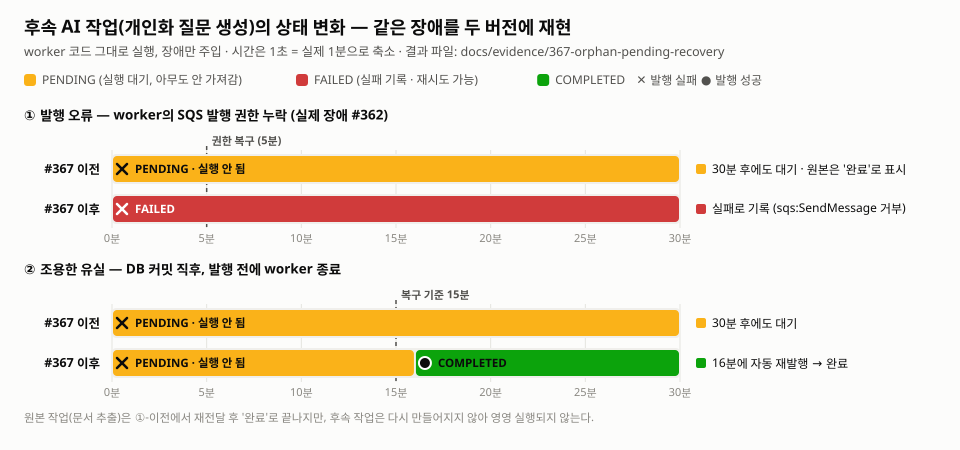

# PR #367 전후 비교: 유실된 후속 AI 작업 복구

[PR #367](https://github.com/seok3m4/init/pull/367)이 고친 문제를 같은 장애 시나리오로 두 버전의 worker 코드에서 재현한 기록이다.
#367 이전에는 후속 작업이 **오류 없이 영원히 `PENDING`으로 남았고**, 이후에는 **실패로 기록되거나 15~17분 안에 자동으로 다시 실행됐다.**

<picture>
  <source media="(prefers-color-scheme: dark)" srcset="./timeline-dark.svg">
  
</picture>

## 결과

| 장애 | #367 이전 (`5bf6eb68`) | #367 이후 (현재 `dev`) |
| --- | --- | --- |
| ① 발행 오류: worker의 `sqs:SendMessage` 권한 누락 (실제 장애 #362) | 원본 작업은 재전달 뒤 **`COMPLETED`**, 후속 작업은 **30분 뒤에도 `PENDING`**. 발행 재시도 0회 | 원본·후속 처리 기록 모두 **`FAILED`**, 사유 `AccessDenied: sqs:SendMessage` 기록. 이미 추출된 문서 결과는 `EXTRACTED`로 유지 |
| ② 조용한 유실: DB 커밋 직후, 발행 전에 worker 종료 | 후속 작업 **30분 뒤에도 `PENDING`**, 처리 0회 | **16분에 같은 작업 ID로 재발행 → `COMPLETED`** (처리 1회) |

- ①-이전이 가장 위험한 경우다. 원본 메시지가 다시 처리되면서 `COMPLETED`로 끝나 **대시보드에는 정상으로 보이지만**, 후속 작업은 이미 배치가 있다는 이유로 다시 만들어지지 않아 영영 실행되지 않는다.
- ①-이후의 `FAILED`는 끝이 아니라 **눈에 보이는 실패**다. 기업 화면의 개인화 질문 재요청 같은 재시도 경로로 다시 실행할 수 있다.
- 표의 상태는 처리 기록(`ai_process_logs`) 기준이다. 발행에 실패해도 이미 추출된 문서 결과는 되돌리지 않으며, 이 동작은 재현 스크립트가 아니라 `report-failure.handler.test.ts`의 "follow-up publish failure does not roll an already extracted document back to failed" 테스트가 보장한다.
- ②의 복구 시점은 실행마다 15~17분이다. 기준 15분이 지난 뒤 1분 간격 스캔이 언제 돌았는지에 따라 달라진다.

원본 데이터: [result-before-denied.json](./result-before-denied.json) · [result-after-denied.json](./result-after-denied.json) · [result-before-crash.json](./result-before-crash.json) · [result-after-crash.json](./result-after-crash.json)

## 재현 방법

[reproduce.ts](./reproduce.ts)가 대상 버전의 `AiWorkerRunner`, InMemory 큐·저장소를 그대로 불러 같은 시나리오를 돌린다.

- 문서 추출 작업(21)이 끝나면 후속 작업(22)을 `PENDING`으로 만들고 발행한다. 실제 코드(`prisma-ai-result.repository.ts`)처럼 같은 지원서로 다시 실행되면 후속 작업을 다시 만들지 않는다.
- `MODE=denied`: 처음 5분 동안 모든 발행이 `AccessDenied` 오류로 실패한다.
- `MODE=crash`: 후속 작업 발행 호출이 끝나지 않고(프로세스 종료), 다음 분부터 새 worker 인스턴스가 이어서 돈다.
- 시간은 1초 = 실제 1분으로 줄였다. 복구 기준 15분과 스캔 간격 1분도 같은 비율로 줄여 `AiWorkerRunner` 옵션으로 넘긴다(운영 기본값은 각각 15분, 1분).

```bash
# 이전 버전 checkout (저장소 밖 임시 폴더 권장)
git worktree add --detach ../init-before-367 5bf6eb68
(cd ../init-before-367/backend/worker && npm ci)

# 각 버전의 backend/worker 폴더에서 실행 (MODE=denied|crash)
cd ../init-before-367/backend/worker
WORKER_SRC=$PWD/src LABEL="before (5bf6eb68)" MODE=crash OUT=<이 폴더>/result-before-crash.json npx tsx <이 폴더>/reproduce.ts

cd <저장소>/backend/worker
WORKER_SRC=$PWD/src LABEL="after (#367 이후 dev)" MODE=crash OUT=<이 폴더>/result-after-crash.json npx tsx <이 폴더>/reproduce.ts

# 그림 다시 그리기
node <이 폴더>/render-chart.mjs
```

## 한계

- DB, SQS, OpenAI는 띄우지 않았다. worker의 InMemory 구현으로 **실행 순서와 상태 전이만** 비교했다. 실제 LocalStack SQS에서의 발행·재발행 확인은 PR #367 본문에 따로 기록돼 있다.
- 처리량이나 응답시간을 잰 것이 아니다. "작업이 다시 실행되는가"만 비교한다.
- 실행 일시: 2026-10-24, Node 20.20.2.
