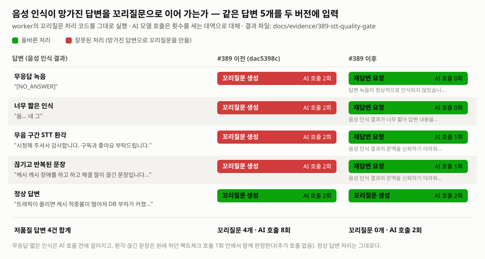

# PR #389 전후 비교: STT 저품질 답변 품질 게이트

[PR #389](https://github.com/seok3m4/init/pull/389)이 고친 문제를 같은 답변 5개로 두 버전의 worker 코드에서 재현한 기록이다.
#389 이전에는 음성 인식이 망가진 답변 **4개 모두로 꼬리질문을 만들었고**, 이후에는 **4개 모두 재답변 요청으로 돌렸다.** 정상 답변 처리와 AI 호출 수는 그대로다.

<picture>
  <source media="(prefers-color-scheme: dark)" srcset="./comparison-dark.svg">
  
</picture>

## 결과

| 답변 | #389 이전 (`dac5398c`) | #389 이후 (현재 `dev`) | 이후 버전이 지원자에게 보여준 사유 |
| --- | --- | --- | --- |
| 무응답 녹음 `[NO_ANSWER]` | 꼬리질문 생성 · AI 호출 2회 | 재답변 요청 · **AI 호출 0회** | 답변 녹음이 정상적으로 인식되지 않았습니다. |
| 너무 짧은 인식 `음... 네 그` | 꼬리질문 생성 · 2회 | 재답변 요청 · **0회** | 음성 인식 결과가 너무 짧아 답변 내용을 확인할 수 없습니다. |
| 무음 구간 STT 환각 `시청해 주셔서 감사합니다…` | 꼬리질문 생성 · 2회 | 재답변 요청 · 1회 | 음성 인식 결과의 문맥을 신뢰하기 어려워 답변을 평가할 수 없습니다. |
| 끊기고 반복된 문장 | 꼬리질문 생성 · 2회 | 재답변 요청 · 1회 | (같음) |
| 정상 답변 | 꼬리질문 생성 · 2회 | 꼬리질문 생성 · 2회 | — |

- **이전 버전의 문제**: `[NO_ANSWER]` 같은 빈 녹음 표시나 STT 환각 문장도 그대로 꼬리질문 모델에 들어가, 지원자가 하지 않은 말에 대해 다시 질문받는다.
- **하드 게이트**: 비어 있거나, `[NO_ANSWER]`이거나, 공백을 뺀 길이가 10자 미만이면 AI를 부르기 전에 걸러진다(AI 호출 0회).
- **의미 판정**: 길이는 충분하지만 문맥이 없는 전사문은 원래 하던 팩트체크 호출 1회의 결과(`transcriptUsability`)로 함께 판정한다. **추가 AI 호출이 없다.** 이전 버전도 같은 팩트체크를 1회 호출했다.
- 저품질 답변 4건 합계: 이전 **꼬리질문 4개 · AI 호출 8회** → 이후 **꼬리질문 0개 · AI 호출 2회**.

원본 데이터: [result-before.json](./result-before.json) · [result-after.json](./result-after.json)

## 재현 방법

[reproduce.ts](./reproduce.ts)가 대상 버전의 `OpenAiAiTaskHandler`를 그대로 불러, 채용 면접 꼬리질문(`RECRUITING_FOLLOW_UP`) 작업 5개를 처리한다.

- 꼬리질문 생성 모델과 팩트체크 모델 호출은 **호출 횟수를 세는 대역(stub)**으로 바꿨다. 실제 OpenAI는 부르지 않는다.
- 팩트체크 대역은 샘플마다 정해 둔 판정을 돌려준다(위 4개는 `UNUSABLE`, 정상 답변은 `USABLE`). 운영에서는 이 판정을 모델이 내린다. 이 재현은 **판정이 나온 뒤 코드가 무엇을 하는지**를 비교한다.
- 이전 버전은 판정 값을 읽지 않으므로 같은 대역을 넣어도 결과가 달라지지 않는다.

```bash
git worktree add --detach ../init-before-389 dac5398c
(cd ../init-before-389/backend/worker && npm ci)

cd ../init-before-389/backend/worker
WORKER_SRC=$PWD/src LABEL="before (dac5398c)" OUT=<이 폴더>/result-before.json npx tsx <이 폴더>/reproduce.ts

cd <저장소>/backend/worker
WORKER_SRC=$PWD/src LABEL="after (#389 이후 dev)" OUT=<이 폴더>/result-after.json npx tsx <이 폴더>/reproduce.ts

node <이 폴더>/render-chart.mjs
```

## 이 재현이 다루지 않는 부분 (테스트로 보장)

#389는 worker 밖의 API 흐름도 바꿨다. 이 부분은 재현 대신 PR에서 추가한 테스트가 보장한다.

| 동작 | 테스트 |
| --- | --- |
| 재답변은 첫 `REANSWER_REQUIRED` 뒤 한 번만 허용, 새 답변을 만들지 않고 기존 답변을 교체 | `interview.controller.spec.ts` — "REANSWER_REQUIRED allows replacing a transcript-bearing answer once without creating a new answer" |
| 의미 판정에 실패한 답변은 저장된 전사문이 있어도 리포트 평가 입력에서 제외 | `report.service.test.ts` — "excludes a saved transcript after semantic quality failure" |
| 하드 게이트 경계(빈 표시, 10자 미만 / 충분한 길이) | `transcript-usability.test.ts` 2개 |

## 한계

- 의미 판정을 고정값으로 넣었으므로, **모델이 실제로 환각 문장을 `UNUSABLE`로 판정하는지**는 이 재현으로 보이지 않는다.
- 꼬리질문 문장은 대역이 만든 것이다. 비교하는 것은 "꼬리질문이 만들어졌는가"이지 문장 내용이 아니다.
- 실행 일시: 2026-10-24, Node 20.20.2.
